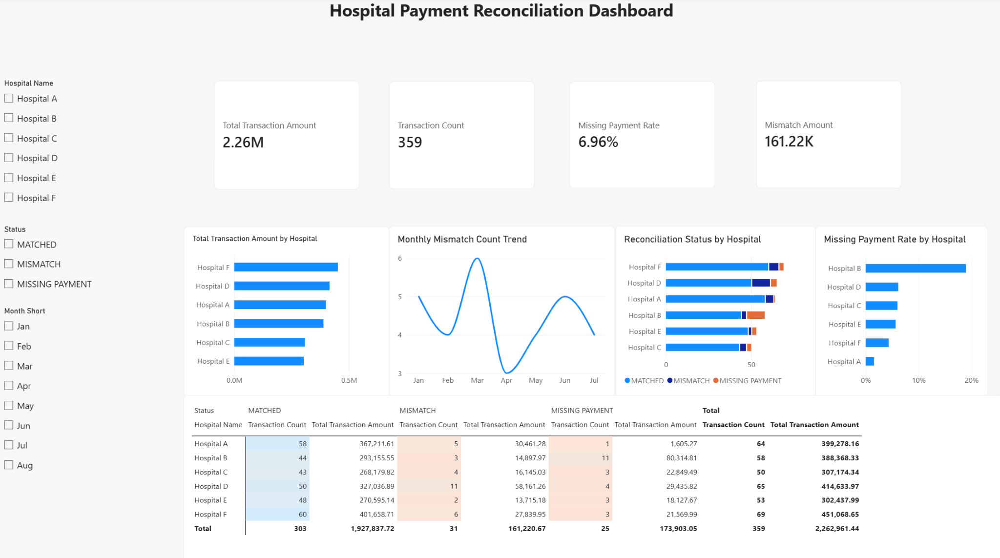

# Hospital Payment Reconciliation Dashboard

Power BI reconciliation dashboard for identifying missing payments, mismatches, and hospital-level payment risks.



## Project Overview

This project simulates a payment reconciliation workflow across multiple hospitals. The goal is to identify missing payments, amount mismatches, duplicate records, and data-quality issues, then present the results through an interactive Power BI dashboard.

The workflow covers data cleaning, reconciliation logic, dimensional modeling, DAX measures, KPI design, exception analysis, and business-focused dashboard development.

## Business Questions

- Which hospitals have the highest missing-payment risk?
- Which periods show abnormal mismatch activity?
- Which hospitals contribute the largest transaction amounts?
- How should duplicate and conflicting transaction records be handled before reporting?

## Key Findings

- **Hospital B** showed the highest missing-payment rate and should be prioritized for investigation.
- **March** recorded the highest mismatch count.
- **Hospital F** had the highest total transaction amount, making it important from an exposure perspective.

## Data Preparation

The dataset was cleaned and transformed in Power Query, including:

- Promoting and validating headers
- Correcting data types and payment-date formats
- Converting invalid amount values to null
- Standardizing hospital and reconciliation-status text
- Removing exact duplicate records
- Retaining conflicting duplicate transaction IDs for review
- Creating a data-quality flag for valid vs. conflict-review records

## Data Model

A one-to-many relationship was created between the hospital dimension and payment transactions using a simple star-schema structure.

## Key Measures

Key DAX measures include:

- Transaction Count
- Total Transaction Amount
- Missing Payment Count
- Missing Payment Rate
- Mismatch Count
- Mismatch Amount
- Mismatch Amount Rate

See the full formulas in [`dax/measures.md`](dax/measures.md).

## Dashboard Components

The dashboard includes:

- KPI cards for total transaction amount, transaction count, missing-payment rate, and mismatch amount
- Hospital-level transaction-amount comparison
- Monthly mismatch-count trend
- Reconciliation-status distribution by hospital
- Missing-payment-rate comparison by hospital
- Matrix analysis with conditional formatting
- Hospital, status, and month slicers

## Tools Used

- Power BI
- Power Query
- DAX
- Excel
- Data Cleaning & Reconciliation
- Dashboard Design

## Repository Structure

```text
hospital-payment-reconciliation-dashboard/
├── README.md
├── dashboard/
│   └── Hospital_Payment_Reconciliation_Dashboard.pbix
├── screenshots/
│   └── dashboard-overview.png
└── dax/
    └── measures.md
```

Additional documentation and sample data can be added later if needed.
